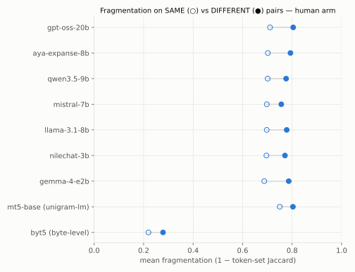
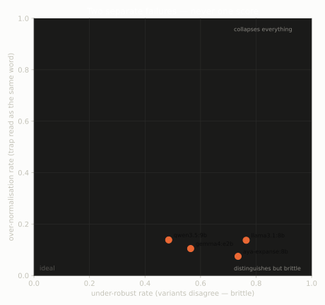

# 2ol 3alatol 

**Same word, many spellings.** A robustness benchmark for Egyptian Arabizi
(Franco-Arabic) that asks, at three levels, whether tokenizers and LLMs treat two
spellings of one word as the same word, and look-alike spellings of different
words as different. It also includes a ~300k-row fine-tuning dataset built to
target the failure it finds.

[](https://github.com/amoorgy/2ol-3alatol/actions/workflows/tests.yml)

[](LICENSE)
[](data/LICENSE.md)

## The problem

Many Egyptians type Arabic in Latin letters, using digits for sounds Latin lacks
(`3` = ع, `7` = ح, `5` = خ, `2` = ء). There is no standard spelling, so the same word
appears in many forms:

| word | spellings seen in real text |
|---|---|
| خلاص "done, enough" | `khalas`, `5alas` |
| حاجة "thing" | `7aga`, `haga` |
| كده "like this" | `keda`, `kda`, `kida` |

Some look-alike spellings are **different words**, though: `men` (من, "from") vs
`meen` (مين, "who"), or `3alam` (علم, "flag") vs `alam` (ألم, "pain"). A robust
system has to do two opposite things: merge real variants and keep look-alikes
apart. This repo measures both and never averages them into one score.

## Results at a glance

| level | question | tested on | headline |
|---|---|---|---|
| **1 · tokenizer** | Do two spellings of one word share tokens, and do look-alikes share fewer? | 9 tokenizers, 102 human-authored pairs + 2,106 NileChat pairs | look-alikes are barely separable: AUC **0.56–0.63** |
| **2 · judgement** | Asked "same word?", what does a model answer? | 4 local LLMs, 102 human-authored pairs | answers SAME **80–100%** of the time (base rate 66%) |
| **3 · comprehension** | Does a word's meaning, in a real sentence, survive a respelling? | 4 LLMs (3 pass the capability floor), 150-item pilot | same word, different spelling → different meaning **49–74%** of the time |

<p>
<picture>
  <source media="(prefers-color-scheme: dark)" srcset="experiments/d5_cohere_track/results/figures/f1_fragmentation_ceiling.dark.svg">
  
</picture>
<picture>
  <source media="(prefers-color-scheme: dark)" srcset="experiments/d5_cohere_track/results/figures/f5_robustness_scatter.dark.svg">
  
</picture>
</p>

## What we found

1. **Token overlap barely separates variants from look-alikes.** For 8 subword tokenizers, two
   spellings of the *same* word have a mean fragmentation (1 − token-set Jaccard)
   of 0.69–0.75 on the human-authored pairs. A *different*-word look-alike
   fragments only slightly more: separability AUC is 0.56–0.63, with 95% CIs
   reaching down to chance. Byte-level ByT5 cuts fragmentation to 0.22 but
   separates no better (AUC 0.59). One of the 9 tokenizers is Aya Expanse's,
   which tokenizes every probe word identically to Command A and Command R7B
   Arabic (same token signature). [Level 1 tables](experiments/d5_cohere_track/results/level1_tokenizer.md)

2. **Models say "same", then read "different".** Asked directly, four local
   models call a pair the same word 80–100% of the time, against a 66% base
   rate ([Level 2](experiments/d5_cohere_track/results/level2_inference.md)). But
   asked for a word's meaning inside a real sentence, the three models that pass
   an Arabic-capability floor give a *different* meaning for two spellings of the
   same word 49–74% of the time. They read a different-word trap as the same word
   only 7–14% of the time. Decoding is deterministic (temperature 0) and the same
   rendering asked twice agrees 100% of the time, so the disagreement comes from
   the respelling, not from run-to-run noise.
   `gemma4:e2b`, the one model in both experiments (on different test sets), says
   SAME 81% of the time yet changes its meaning for 56% of same-word pairs.
   [Level 3 tables](experiments/d5_cohere_track/results/level3_meaning.md)

3. **No model is good at both.** `qwen3.5:9b` is the most robust and the most
   trap-fooled; `aya-expanse:8b` is the reverse. `llama3.1:8b` fails the
   capability floor, so its numbers measure incapacity, not orthography, and are
   excluded from the ranges above.

4. **Safe digit swaps are the weak spot.** Swapping a digit spelling for its
   letter equivalent (`5alas` ↔ `khalas`) changes the model's answer for 89–100%
   of variant pairs (27 pairs per model in the 150-item pilot). On the NileChat
   arm, these swaps also fragment most of the classes with at least 20 pairs
   (0.77 averaged over 9 tokenizers), in line with the pre-registered prediction.
   The spec said "single-edit classes"; the n ≥ 20 cutoff is ours, and about half
   of these pairs also carry a second change. The companion prediction, that
   final `y`/`i` fragments least, did not hold.

5. **Fragmentation does not explain the comprehension failures.** The
   pre-registered joint test (does a model's own-tokenizer fragmentation predict
   where its comprehension breaks?) gives Spearman ρ = 0.24 (p ≈ 0.12) across 44
   model × phenomenon cells, all four models included. The
   [design spec](docs/design/2026-08-20-cohere-track-design.md) pre-registered a
   per-item join with bootstrap CIs; this pilot reports the per-phenomenon
   aggregate instead. Per the spec's null rule, the weak result is reported as is,
   with no further slicing.

6. **Spelling rules can't certify word identity.** Most NileChat word pairs that
   share a consonant skeleton can be explained by spelling rules, yet that bucket
   still mixes true variants with different words (`men` / `meen`). So no
   normalizer can promise identity from orthography alone. Here, SAME pairs are
   *generated* (identity holds by construction) and traps are *mined*.

Full write-up, with provenance for every table and all nine figures:
[`experiments/d5_cohere_track/results/`](experiments/d5_cohere_track/results/README.md).

## The fine-tuning dataset (v2)

Because the failure is brittleness, the dataset teaches both rules at once:
different spellings of one word mean the same thing (*normalize* rows), and some
look-alikes are different words (*meaning* rows).

| file | train | val | row |
|---|---:|---:|---|
| `mixed` | 269,306 | 29,904 | both types, shuffled |
| `normalize` | 267,579 | 29,719 | sentence in mixed spellings → base spelling |
| `meaning` | 1,727 | 185 | sentence + one word → that word in Arabic script |

- **Prose is generated, orthography is ruled.** No model ever writes a spelling.
  Every respelling applies a licensed rule
  ([`licensing.py`](src/franco_eval/licensing.py)), so a respelled word is meant
  to be the same word by construction. Councils audit that claim (they flagged
  107 of 1,899 generated probe variants invalid), and the datasheet sizes the
  residual error.
- **98.9% of rows come from corpus sentences.** 296,024 rows respell 152,707
  NileChat sentences (Egyptian web text that Command R+ transliterated to
  Arabizi): 158,452 were collected from all 571,524 documents, and 5,745 had too
  few respellable words. The rest are synthetic sentences written around the
  confirmed trap words.
- **Synthetic sentences use Fusion-of-N** ([Khairi et al., 2025](https://arxiv.org/abs/2510.00931), Cohere Labs).
  Five teacher models draft, and one fusor merges the drafts. The teachers and
  the fusor never write the anchor word, its Arabic form or its meaning: those
  come from the committed trap-council verdicts (LLM judges, not yet
  native-confirmed), and gates check that the anchor survives byte-for-byte.
- **Verified by LLM councils, with errors sized.** 6,804 flagged substitution pairs
  and 1,122 fused sentences were judged by 5-lens panels (707 sentences accepted).
  The [datasheet](data/training/v2/DATASHEET.md) puts a number on each known
  error source.
- **Held-out split.** 275 of the 500 probe words, their traps and every
  human-arm word are never respelled, never used as a fusion anchor and never
  asked about in training. They still occur, unchanged, as ordinary context
  words. Evaluate only on that side.

Row files are too large for git and regenerate from tracked inputs; a
[200-row sample](data/training/v2/sample.jsonl) is committed.

**Side finding: a [Fusion-of-N pilot](experiments/d5_cohere_track/results/fusion_pilot_overview.md).**
For all three fusors, fusing five drafts beat a selection baseline: the first
teacher draft that passes the same gates, with no reward model picking it. Fusion
won 65–94% of the judged comparisons, with ties counted as non-wins (87% with
Command R 35B as the fusor), which is consistent with the paper's central claim.
But no configuration came close to `deepseek-v4-pro` prompted directly (0–11%).
Against the smaller `deepseek-v4-flash`, the 743B fusor roughly tied. That
suggests the teacher pool, more than the fusor, sets the ceiling. These
comparisons are small: 14–18 judged pairs per fusor and comparison, with one
Claude judge.

## How the numbers stay honest

- **Provenance on every row.** The *human* arm (102 labelled pairs, mined from 489
  human-authored messages plus 11 author-written clusters) and the
  *machine-derived* arm (NileChat Arabizi, i.e. Egyptian web text
  transliterated by Command R+) are always reported separately. Level 1 runs on
  both arms, and they agree. Level 3 and the joint test have run on the
  machine-derived arm only so far (see Limitations). Machine-derived text never
  becomes a benchmark artifact.
- **Controls before claims.** Deterministic decoding plus a same-rendering
  ceiling rule out run-to-run noise. An Arabic-capability floor keeps models that
  can't do the task out of the ranking.
- **Pre-registration, including of the null.** Predictions and the joint analysis
  were written into a dated design spec before any Level 1–3 result was computed.
- **LLM councils for judgement calls, with committed verdicts.** Panels of 3–5
  judges, each reading through a different lens, decide stimulus validity. Every
  verdict is a committed TSV, so every number regenerates without calling a
  model. Agreement is reported for every council. Fleiss' κ is 0.875 for trap
  confirmation (314 of 418 traps at ≥ 4/5 judges), 0.29–0.39 for variant and
  respelling validity, and 0.12 for fused-sentence quality, where the lenses
  deliberately judge different things. The panels themselves were
  [calibrated against each other](experiments/d5_cohere_track/results/), which
  showed a cheaper panel missing most of a stronger panel's rejections, and that
  gap is stated in the datasheet.
- **Reproducible end to end.** Fixed seeds and prompt-hashed response caches. A
  manifest records every input, output and package version. Gated tokenizers are
  replaced by public mirrors. Where a signature is pinned (Aya Expanse,
  NileChat-3B), a mirror that doesn't reproduce it aborts the run. The Llama 3.1
  stand-in has no pin.

## Quickstart

```bash
git clone https://github.com/amoorgy/2ol-3alatol.git && cd 2ol-3alatol

# No dependencies needed for these: stock Python 3.14
python3 -m unittest discover -s tests              # 588 tests, under 20 s (12 dataset
                                                   # contract tests skip until you build it;
                                                   # on Linux, 10 more need macOS caffeinate)
python3 experiments/d1_benchmark/run_showcase.py   # D1 baseline (below), seconds

# Evaluation track: tokenizers and figures
python3 -m venv .venv && .venv/bin/pip install -r requirements-eval.txt
.venv/bin/python experiments/d5_cohere_track/e1_variant_probe/run_level1_tokenizer.py
PYTHONPATH=src .venv/bin/python -m visualization.render_all \
    --results-dir experiments/d5_cohere_track/results
```

Level 3 needs [Ollama](https://ollama.com) with the four models pulled. Responses
are cached by prompt hash, and `--dry-run` works with Ollama stopped. The
stimulus and dataset builders also need the NileChat corpus (about 900 MB; the
committed tables don't):

```bash
.venv/bin/hf download UBC-NLP/nilechat-arabizi-egy --repo-type dataset \
    --local-dir data/external/nilechat_arabizi_egy
```

Every command for every table: [results README](experiments/d5_cohere_track/results/README.md#reproduce),
[stimulus pipeline](experiments/d5_cohere_track/nilechat_wordset/README.md),
[dataset](data/training/v2/DATASHEET.md#regenerate).

## Where it started: the D1 baseline

The first instrument (Direction 1) was simpler: a character-trigram retriever over
489 human-authored messages, queried with respelled 4-word fragments. Normalizing
both sides to this repo's canonical Franco form ([`normalize.py`](src/franco/normalize.py))
lifts recall@1 from **0.850 to 0.871** when the respellings are real ones mined
from the corpus. That is a mean over 5 seeds of about 58 queries each, and the
per-seed change ranges from −0.02 to +0.05, so the gain is small and noisy. The synthetic-noise sweep, and the leakage diagnostic it needs,
are in [`results/showcase.md`](results/showcase.md). The variant clusters D1 mines
are also the input to the human-authored pairs used at Levels 1 and 2.

## Repository map

```text
src/
  franco/            stdlib core: phonemic skeleton, 31-rule spelling taxonomy,
                     normalizer, perturber, variant miner, metrics
  franco_eval/       phenomenon classes, tokenizer metrics, licensed variants,
                     PPMI context model, meaning metrics, fusion gates, model clients
  visualization/     figure pipeline (stdlib data prep, matplotlib rendering)
experiments/
  d1_benchmark/      D1 baseline: retrieval under respelling
  d5_cohere_track/   Levels 1–3, NileChat stimulus pipeline, dataset builders,
                     results/ + figures/
data/
  seed/              human-authored Franco messages: the human arm's only source
  benchmark/         102 labelled SAME / DIFFERENT pairs and the inputs that build them
  stimulus/          NileChat probe stimuli and every committed council verdict
  training/          dataset cards, stats and samples
tests/               588 stdlib unittest tests
docs/                research plan, plain-language primer, design specs, future directions
```

New to the topic? [`docs/BACKGROUND.md`](docs/BACKGROUND.md) explains every
concept in plain language. The full research plan, including three planned
follow-up directions (an Arabizi→Arabic transliterator, variant-invariant
embeddings, a tokenizer study), is in
[`docs/FRANCO_RESEARCH_PLAN.md`](docs/FRANCO_RESEARCH_PLAN.md) and
[`docs/directions/`](docs/directions/).

## How this was built

This is a solo project, built with Claude Code as an agentic pair programmer and
kept honest by explicit rules:

- **Five scoped agents** ([`.claude/agents/`](.claude/agents/), mirrored for Codex
  in [`.codex/agents/`](.codex/agents/)). Each owns one kind of artifact; see
  [`docs/AGENTS.md`](docs/AGENTS.md).
- **LLM councils** make the judgement calls, as described above.
- **Tests first**: 588 of them, stdlib only, run on every push.
- [`CLAUDE.md`](CLAUDE.md) (mirrored as [`AGENTS.md`](AGENTS.md)) holds the
  project rules the agents read. [`changes.md`](changes.md) is the dated lab
  notebook of every session, including the bugs found and why each decision went
  the way it did.

## Limitations

1. **Native-speaker review is partial.** The substitution-policy rulings are
   signed off. Not yet reviewed: the council verdicts, the taxonomy weights, the
   trap Arabic forms, and the SAME/DIFFERENT labels on the mined human-arm pairs
   (meaning partitions drafted by Claude; the `confirmed` column is still blank).
2. **Level 3 is a pilot.** It covers 150 items × 4 models, on the machine-derived
   arm only. Per-phenomenon cells under n = 20 are faded in every figure and
   aren't individually defensible. The capability floor is 30 words at a 0.5
   bar, and aya (16/30) and qwen (17/30) pass narrowly.
3. **"Attested" on the NileChat arm means attested in Command R+ output**, not in
   human writing.
4. **Prompts are in English.** The prompt-language confound is not measured yet.
5. **The dataset is built but not yet trained on.** Next steps: fine-tune, evaluate
   on the held-out words, and merge the trap-run sentences that are already
   judged (8,695 judged by a GLM-5.3 council, 7,153 accepted at ≥ 3/5; see
   `data/stimulus/fusion_v4_trap_votes.tsv`).

## License, citation, acknowledgements

- **Code**: [MIT](LICENSE).
- **Data** (`data/`): [CC BY-NC 4.0](data/LICENSE.md). Most of it derives from
  NileChat Arabizi-EGY, which is CC BY-NC 4.0.
- **Cite**: see [`CITATION.cff`](CITATION.cff) (GitHub's "Cite this repository").

Built on [NileChat Arabizi-EGY](https://huggingface.co/datasets/UBC-NLP/nilechat-arabizi-egy)
(UBC-NLP; [El Mekki et al., EMNLP 2025](https://aclanthology.org/2025.emnlp-main.556/)),
on Fusion-of-N ([Khairi, D'souza, Fadaee & Kreutzer, 2025](https://arxiv.org/abs/2510.00931)),
and on the open-weight models and tokenizers it measures: Aya Expanse, Gemma, Qwen,
Llama, Mistral, gpt-oss, mT5 and ByT5.
