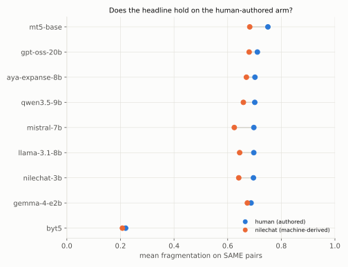
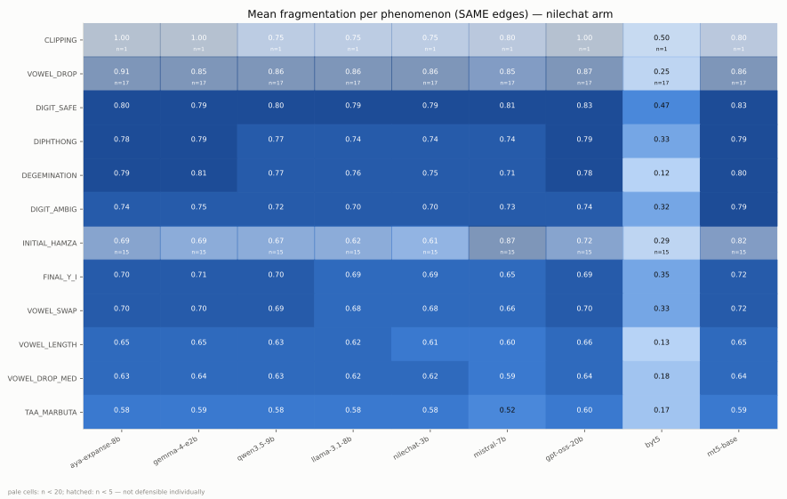
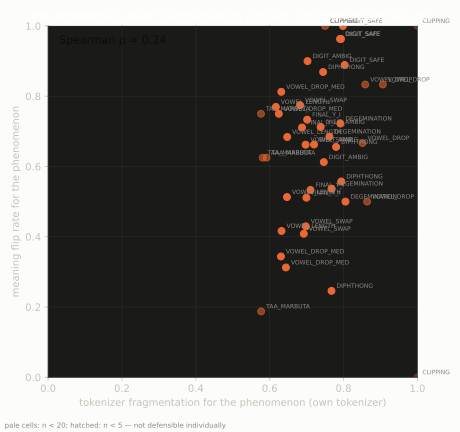

# d5 Cohere track — results

Generated 2026-08-22. Regenerate: see **Reproduce** at the bottom; provenance
and environment for every table are in [`manifest.json`](manifest.json).

## Provenance — read this before any number

| asset | provenance | licence | human-authored? | used for |
|---|---|---|---|---|
| `data/benchmark/pairs.csv` (102 pairs) | mined + hand from `data/seed/` | project | **yes** | the control arm every headline must hold on |
| `data/stimulus/nilechat/stimuli_v1.csv` (2,817 rows) | **machine-derived** — Command R+ transliteration (`nilechat-arabizi-egy`) | CC-BY-NC-4.0 | no | measurement corpus / probe stimulus only, never a benchmark artifact |
| `data/stimulus/nilechat/*_votes.tsv` | LLM council (Claude Opus, 5+3 lenses), committed verdicts | project | no — flagged for native review | gates which rows are scored |
| `data/stimulus/arabic_control_v1.tsv` | author-written | project | yes | capability floor |

Council verdicts are **committed files**; every number regenerates from them,
never from a live model. Confirmed traps: 314/418 at ≥4/5 judges, Fleiss'
κ = 0.875. Variant invalidations: 107/1,899 (κ = 0.29 across three deliberately
different lenses). `confirmed` by a native speaker: still **none** — that
remains the top open item.

## What was asked

Franco/Arabizi has no standard spelling. Three levels of one question: can a
**tokenizer** tell a real spelling variant from a different-word look-alike
(Level 1); does a **model** judge two spellings as same/different (Level 2,
frozen); does a model **understand** the same word across spellings inside a
real sentence (Level 3). Traps exist so a model cannot win by collapsing
everything: variants should agree, traps should disagree, and the two failure
rates are never combined into one score.

## Headline, human arm first

On the 102 human-authored pairs, every tokenizer's separability AUC sits in
0.56–0.63 — barely above chance, CIs touching 0.5 (aya-expanse
[0.51, 0.72]). The same instrument on the ~20×-larger machine-derived arm gives
the same band (aya [0.58, 0.65]) — the finding transfers across provenance,
which is what hard rule 1 demands (figure F4).



## Level 1 — tokenizers ([tables](level1_tokenizer.md))

Every subword tokenizer fragments SAME-word variants at 0.625–0.750
(token-set Jaccard distance, both arms); the byte-level control sits at
**0.21–0.22** — the gap is what subword vocabularies cost on this orthography
(F1). Separability is near-chance everywhere (F2). Per-phenomenon (F3), the
pre-registered prediction was "DIGIT_SAFE fragments worst among single-edit
classes, FINAL_Y_I least" (design spec §5). **Half held:** on the NileChat arm
DIGIT_SAFE fragments worst of the classes with ≥ 20 edges (0.769 mean across
tokenizers), so the mappings easiest for a human to reverse (kh↔5) are the
hardest for a tokenizer to unify; but FINAL_Y_I is mid-pack (0.657), and the
least-fragmented class is TAA_MARBUTA (0.530), a class added after the
pre-registration. The spec said "single-edit classes"; the n ≥ 20 cutoff is
ours, and about half of the DIGIT_SAFE pairs also carry a second change. The
human arm is too small per class (all but one class has n < 20) to rank.




Gated repos are replaced by ungated mirrors (see the mirror table in
[level1_tokenizer.md](level1_tokenizer.md)). Where a signature is pinned (Aya
Expanse, NileChat-3B), a mirror that doesn't reproduce it aborts the run; the
Llama 3.1 stand-in (`unsloth/Meta-Llama-3.1-8B`) has no pin, because the gated
original never loaded in a committed run. A non-optional load failure aborts
the run rather than writing a complete-looking file.

## Level 2 — pair judgement (frozen, human arm only)

Retained verbatim from 2026-08-20 ([tables](level2_inference.md)): all four
local models answer SAME far above the 0.657 base rate; scale does not fix it.
Superseded as headline by Level 3 but kept as the source of that finding.

## Level 3 — in-context word-meaning consistency ([tables](level3_meaning.md))

150-item pilot × 4 models (nested hash-stratified subset of 500; scale-up is
cache-incremental). Prompt shows the carrier sentence, asks for a one-word
Arabic meaning of the target; scoring is agreement across renderings — no gold
needed. Decoding is deterministic (temperature 0, seed 13) and the ceiling
condition (same rendering asked twice) is ≈ 1.0 for all models, so
disagreement is spelling sensitivity, not run-to-run noise.

| model | floor | agreement | under-robust | over-norm | non-answer |
|---|---|---|---|---|---|
| qwen3.5:9b | 0.57 PASS | **0.515** | 0.485 | **0.138** | 0.000 |
| gemma4:e2b | 0.87 PASS | 0.436 | 0.564 | 0.105 | 0.040 |
| aya-expanse:8b | 0.53 PASS | 0.265 | 0.735 | **0.074** | 0.002 |
| llama3.1:8b | **0.23 FAIL** | ~~0.236~~ | ~~0.764~~ | ~~0.137~~ | 0.152 |

The 2×2 tension is visible (F5): **qwen is the most robust AND the most
trap-fooled; aya is the least trap-fooled and the most brittle.** No model
approaches the ideal corner. llama fails the Arabic-script capability floor,
so its row measures incapacity, not orthography (struck through, F8). How
`score()` computes every one of these numbers, including the denominator and
None-handling rules behind the 2×2: [meaning_metrics_reference.md](meaning_metrics_reference.md).


Per phenomenon (F7): flips concentrate in **DIGIT_SAFE** (0.89–1.00 across the
floor-passing models, 27 pairs each) — converging with Level 1's heatmap from an
entirely different measurement. (CLIPPING also scores high but has a single
pair.)

## Joint — does fragmentation explain comprehension failure?

Pre-registered (design spec §8): **Spearman ρ = 0.24** across 44
model × phenomenon cells, between a model's own tokenizer's per-phenomenon
fragmentation and its meaning flip rate (F9; weak, not significant at this n).
Per the pre-registration, this near-null is the reported finding and no further
slicing was performed. (The spec pre-registered a per-item join with bootstrap
CIs; this pilot reports the per-phenomenon aggregate that F9 draws.)
Fragmentation and comprehension failure agree on DIGIT_SAFE (high on both).
TAA_MARBUTA is the least-fragmented class and has the lowest mean flip rate, but
on 16 pairs per model with a wide spread across models (0.19–0.63). The middle
of the distribution does not line up.



## A finding about method, measured on the way

Mining variants from a corpus cannot supply a SAME arm: most co-skeleton
NileChat pairs converge under `classify_edge` (93% in an exploratory
measurement that no committed script regenerates), and that bucket mixes true
variants with different words (`men`~`meen`, من/مين, reads as clean
VOWEL_LENGTH). **Orthographic explainability is not word identity** — which
also bounds what any normalization pipeline can promise. Variants here are
therefore generated (same-word by construction) and traps mined from exactly
those converged look-alikes, ranked by PPMI context dissimilarity calibrated
on the human arm (AUC 0.873, [context_calibration.json](context_calibration.json)).

## Limits

1. **No native-speaker confirmation yet** on council verdicts, taxonomy
   weights, or trap Arabic forms (`reviewer` column empty throughout).
2. Pilot n = 150 items; per-phenomenon cells under n=20 are faded/hatched in
   every figure and not individually defensible.
3. "Attested" means attested in Command R+ output, not human writing.
4. The prompt-language confound is unmeasured until the `--prompt-lang arz`
   pilot arm runs.
5. Council open items (Q_TO_2 disagreement, missing habits):
   [`council_pass1_open_items.md`](../../../data/stimulus/nilechat/council_pass1_open_items.md).

## Reproduce

```bash
python3 -m unittest discover -s tests                      # 588 tests, no venv

.venv/bin/python experiments/d5_cohere_track/nilechat_wordset/build_wordset.py
.venv/bin/python experiments/d5_cohere_track/nilechat_wordset/mine_traps.py
.venv/bin/python experiments/d5_cohere_track/nilechat_wordset/build_variants.py
.venv/bin/python experiments/d5_cohere_track/e1_variant_probe/run_level1_tokenizer.py
.venv/bin/python experiments/d5_cohere_track/e1_variant_probe/run_level3_meaning.py \
    --models "llama3.1:8b,aya-expanse:8b,gemma4:e2b,qwen3.5:9b" --limit 150
PYTHONPATH=src .venv/bin/python -m visualization.render_all \
    --results-dir experiments/d5_cohere_track/results
.venv/bin/python experiments/d5_cohere_track/write_manifest.py
```

`--dry-run` / `--cache-stats` on the meaning runner work with Ollama stopped.
`run_level1_tokenizer.py --offline` proves the tokenizer run needs no network.
